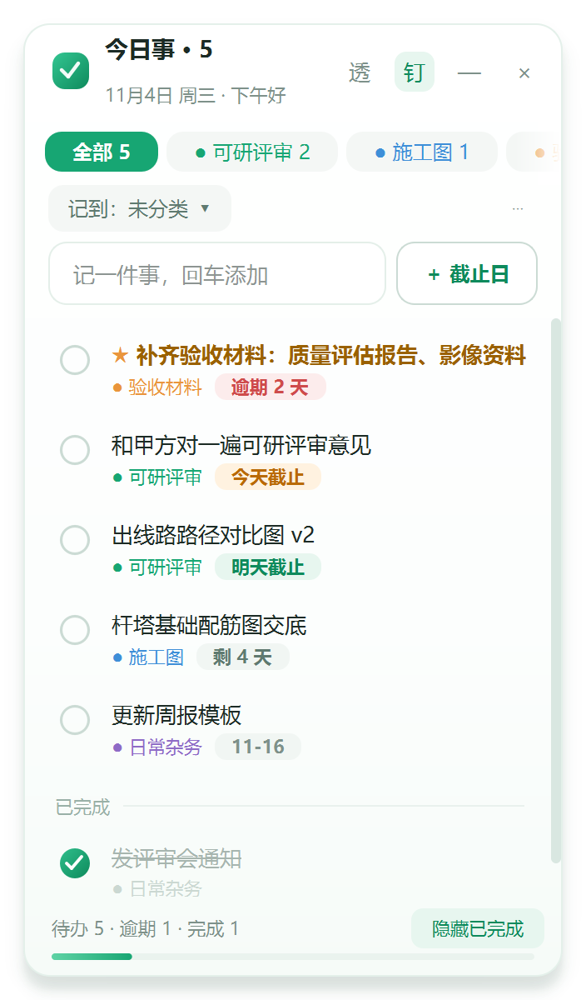
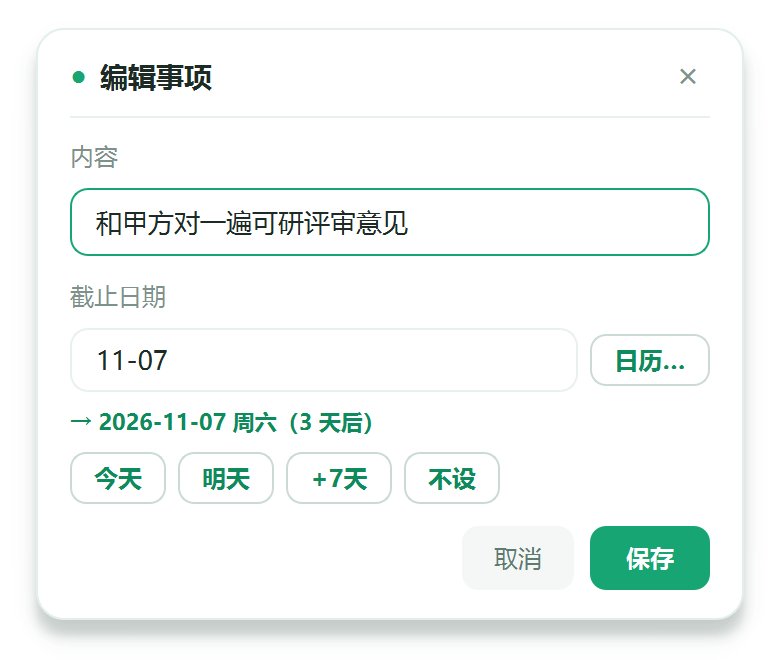

# 今日事 · Desktop To-Do List

> 一块钉在桌面上的多项目 deadline 台账。不联网、不要账号、不占任务栏，数据全在本地一个 JSON 文件里。



---

## 目录

- [为什么又造一个待办轮子](#为什么又造一个待办轮子)
- [核心功能](#核心功能)
- [界面](#界面)
- [快速开始](#快速开始)
- [使用速查](#使用速查)
- [数据文件](#数据文件)
- [项目结构](#项目结构)
- [实现说明](#实现说明)
- [常见问题](#常见问题)
- [路线图](#路线图)
- [许可](#许可)

---

## 为什么又造一个待办轮子

起因很朴素：手上同时压着几个项目，每件事的截止日都不一样，脑子里记不住，打开一个待办 App 又要先登录、再翻找、再切项目——**麻烦到懒得用**。

于是先横向看了一圈现成工具：

| 工具 | 桌面常驻 | 免账号 | 多项目 / 截止日 | 未选用的原因 |
|---|:--:|:--:|---|---|
| Microsoft To Do | ✗ | ✓ | ✓ | 没有真正的桌面常驻小窗，得主动打开 |
| 滴答清单 | 部分 | ✗ | ✓ | 桌面小部件功能堆砌，同步/清单/番茄等大量功能需会员 |
| Todoist | ✗ | ✗ | ✓ | 免费版功能阉割，核心是网页/App |
| 便签 / Sticky Notes | ✓ | ✓ | ✗ | 只能记事，没有项目、没有截止日、不会提醒 |
| Rainmeter 皮肤 | ✓ | ✓ | 部分 | 要自己折腾皮肤和脚本，维护成本高 |

共同短板有两条：**要账号**（事情还没记，先填一堆注册信息），以及**打开才看得见**（放在那里不动就永远想不起来）。

所以要的就是一件很窄的东西：**一个永远在眼前、一眼看完所有项目和截止日、点一下就勾掉的小卡片**。不追求功能齐全，只追求"不用打开也看得见"。

---

## 核心功能

**多项目台账**
顶部一排项目标签，每个标签带未完成数量角标。点「全部」看所有事，点某个项目只看那一个。项目名和颜色都能改，删项目不会删事情。

**截止日 + 五档颜色**
每条事情挂一个截止日，按紧迫程度自动分级显示：`逾期 2 天` / `今天截止` / `明天截止` / `剩 4 天` / `11-16`。列表永远按最近的截止日排前面，标了 ★ 的插队到最顶。
当天到期的会在上午 9 点后弹**一次**托盘提醒；逾期的不反复弹，靠列表里的红色自己盯着。



**日期不用点日历**
在输入框里直接写就行，会自动识别并从正文里摘出去：

```
补齐可研报告 11-06
11-20 交标书
整理验收材料 明天
和专家对意见 今天
出对比图 3天后
开评审会 下周一
```

支持 `11-06`、`11/6`、`12月1日`、`2027-01-31`、`今天`、`明天`、`后天`、`N天后`、`周五`、`下周一`。

**改内容和改日期都只要双击**
双击任意一条 → 弹窗里「内容」和「截止日期」并排改。日期框可以手打 `明天`、点「日历…」挑、或点「今天 / 明天 / +7天 / 不设」；下方实时回显 `→ 2026-11-07 周六（3 天后）`。已经记好的事，也可以直接点它后面的日期小标签改。

**勾错了能撤回**
点圆圈算完成，文字划线并挪到列表下方「已完成」分组——**不会消失**。再点一次圆圈立刻回到待办，右键也有「撤销完成（放回待办）」。

**钉在桌面上但不碍事**
无边框悬浮小窗，可置顶、可拖到任何位置、可折叠成一条、可收进系统托盘。右上角「透」可调 100%→50% 半透明，鼠标移进窗口自动变清晰，移开又变淡。

**数据只在本机**
所有内容写进 `%LOCALAPPDATA%\TodayPlan\data.json`，纯文本。没有云端、没有埋点、没有网络请求。换电脑拷这个文件就行，备份也是拷它。

数据之所以不放在程序目录，是因为程序可能被解压到 `C://Program Files` 这类没有写权限的位置，或者在压缩包里直接双击运行（Windows 会把它展开到临时目录）——那两种情况都会让记录在重启后消失。老版本放在同级的 `data.json` 会在首次运行时自动迁移过去。

---

## 界面

| 区域 | 说明 |
|---|---|
| 标题栏 | 程序名 + 未完成数；右侧 `透`（透明度）、`钉`（置顶）、`—`（折叠）、`×`（收进托盘） |
| 项目标签 | 「全部 + 各项目」，带未完成数量；横向滚轮滑动 |
| 输入区 | 「记到：项目」选归属，右侧「＋ 截止日」给新事定日期，输入框回车即添加 |
| 列表 | 按截止日排序，项目色点 + 日期标签；已完成沉底并划线 |
| 底栏 | 待办 / 逾期 / 完成统计、完成进度条、「隐藏已完成」开关 |

---

## 快速开始

### 方式一：直接跑源码（推荐先试这个）

需要 **Python 3.9+**（实测 3.13）和 Windows 10/11。

```bash
git clone https://github.com/fangshunv-glitch/Desktop-To-Do-List.git
cd Desktop-To-Do-List
pip install -r requirements.txt
python main.py
```

Windows 上也可以直接双击 **`run.bat`**，它会检查依赖并静默启动（不弹黑窗）。

### 方式二：打包成免安装 exe

```bash
pip install pyinstaller
python -m PyInstaller --noconfirm --clean --windowed --onedir ^
    --name TodayPlan --icon icon.ico --distpath dist --workpath build main.py
```

Windows 上直接双击 **`build.bat`** 即可，产物在 `dist\TodayPlan\TodayPlan.exe`。
打包体积约 110 MB（PySide6 运行时占大头），`dist\TodayPlan` 整个目录一起拷走就能在别的机器上跑，无需装 Python。

> 想放桌面：右键 `TodayPlan.exe` → 发送到 → 桌面快捷方式。

### 方式三：开机自动启动

`Win + R` → 输入 `shell:startup` → 回车，把桌面快捷方式拖进这个文件夹。

---

## 使用速查

| 想做的事 | 操作方法 |
|---|---|
| 新建项目 | 项目标签最右侧 `＋`，输入名字 |
| 重命名 / 删除项目 | 项目标签上右键 |
| 添加事情 | 输入框写一句 → 回车（可顺带写日期） |
| 给新事定截止日 | 输入框右边「＋ 截止日」，或直接写「明天」「11-06」 |
| 改内容 + 改日期 | **双击那一行** |
| 只改日期 | 点事情后面的日期小标签，或右键 →「只改截止日期」 |
| 清除截止日 | 右键 →「清除截止日期」，或日历里点「清除」 |
| 标记完成 | 点左边圆圈 |
| 撤回完成 | 再点一次圆圈 / 右键 →「撤销完成」 |
| 标为重要（★） | 输入时以 `!` 开头，或右键 →「标为重要」 |
| 换项目 | 右键 →「移动到项目」 |
| 删除 | 鼠标移上去点右侧 `×`，或右键 →「删除」 |
| 调透明度 | 右上角 `透` |
| 改窗口大小 | 拖右下角 |
| 拖动窗口 | 按住顶部标题条 |
| 收进托盘 / 彻底退出 | 右上角 `×` / 托盘图标右键 → 退出 |

更细的说明见 **[使用说明.md](使用说明.md)**。

---

## 数据文件

程序首次运行会在 `%LOCALAPPDATA%\TodayPlan\` 下自动生成 `data.json`：

```json
{
  "version": 2,
  "projects": [
    { "id": "p1", "name": "可研评审", "color": "#17A673" }
  ],
  "tasks": [
    {
      "id": "t1",
      "pid": "p1",
      "text": "和甲方对一遍可研评审意见",
      "due": "2026-11-04",
      "star": false,
      "done": false,
      "done_at": null,
      "created": "2026-11-02T10:20:00",
      "notified": false
    }
  ],
  "settings": {
    "on_top": true, "folded": false, "show_done": true,
    "opacity": 1.0, "hover_opaque": true, "filter": "all", "ui_ver": 2
  }
}
```

| 字段 | 含义 |
|---|---|
| `projects[].id / name / color` | 项目 id、名称、标签色 |
| `tasks[].pid` | 所属项目 id，空串表示「未分类」 |
| `tasks[].text` | 正文（不含日期，日期已被摘出去） |
| `tasks[].due` | 截止日 `YYYY-MM-DD`，`null` 表示不限期 |
| `tasks[].star` | 是否重要（影响排序和字重） |
| `tasks[].done / done_at` | 是否完成 / 完成时间（用于已完成区倒序） |
| `tasks[].notified` | 当天提醒是否已弹过，避免重复打扰 |
| `settings` | 窗口位置大小、透明度、置顶、当前筛选、折叠状态等 |

仓库里的 **[data.example.json](data.example.json)** 是一份示例数据，想先看效果可以复制成 `data.json`：

```bash
cp data.example.json data.json
```

> `data.json` 已加入 `.gitignore`——**它属于你自己，不该进版本库**。
>
> 改动建议直接用程序界面或 Python 读写。如果用 Windows 脚本（如 `ConvertTo-Json | Out-File -Encoding utf8`）重写，会带上 UTF-8 BOM，程序虽然兼容读取（`utf-8-sig`），但仍有踩坑风险。真写坏了也不会丢数据：程序会把原文件另存为 `data.broken.json` 再启动。

---

## 项目结构

```
Desktop-To-Do-List/
├── main.py                  # 全部逻辑与界面（单文件，约 2300 行）
├── make_icon.py             # 生成绿色渐变图标 icon.ico
├── icon.ico                 # 程序图标
├── TodayPlan.spec           # PyInstaller 打包配置
├── build.bat                # Windows 一键打包
├── run.bat                  # Windows 一键运行（源码）
├── requirements.txt
├── data.example.json        # 示例数据
├── 使用说明.md               # 面向使用者的详细说明书
├── README.md
├── LICENSE
└── assets/                  # README 配图
    ├── screenshot-main.png
    └── screenshot-edit.png
```

单文件不是偷懒：整个程序就是"一个窗口 + 一棵列表 + 一个 JSON"，拆成十几个模块反而要来回跳。代码内按 `常量 → 数据层 → 日期解析 → 自绘控件 → 弹窗 → 任务行 → 主窗口` 分段，段间有分隔注释。

---

## 实现说明

用 **PySide6**（Qt for Python）自绘，没有用任何 UI 框架皮肤。几个值得一提的点：

- **无边框悬浮窗**：`FramelessWindowHint | Tool | WindowStaysOnTopHint` + `WA_TranslucentBackground`。用 `Tool` 而不是普通窗口，避免在任务栏留一个占位。
- **半透明只做底板**：QSS 里用 `rgba(255,255,255,alpha)` 给卡片背景，文字始终实色。早期的 `setWindowOpacity` 方案会把文字一起淡化，已经弃用。
- **单实例**：`QLocalServer` 做实例锁，重复双击不会开第二个窗口，而是把已有窗口叫到前面。
- **自绘控件**：圆形勾选框、完成度细进度条、空状态插画、品牌标、通用弹窗都用 `QPainter` 画，配色统一在一组设计 token 里。
- **自绘弹窗**：系统 `QInputDialog` 在贴屏幕边缘时会被通知面板等置顶窗口压住、还拖不动，所以换成自绘 `CardDialog`（屏幕居中、整块可拖、回车确定 / Esc 取消）。
- **日期解析**：两条正则分开匹配「11-06 风格」和「3天后 / 周五 风格」，避免分组错位；编辑弹窗里另有 `parse_date_only()`，不要求剩余文本。

已踩过并记录在案的坑（写在这里省得别人再踩）：

| 现象 | 原因与解法 |
|---|---|
| 删除线不生效 | Qt 富文本不支持 CSS `text-decoration`，必须 `QFont.setStrikeOut(True)` |
| 按钮文字被挤成 `…` | 固定 24×24 太小，按内容给 `setFixedSize(46, 24)` |
| 切项目后标签栏塌陷 | `QScrollArea(widgetResizable=False)` 会缓存 0 宽度，改为逐个按钮累加 `sizeHint` |
| 整个窗口突然变全透明 | QSS 的 `rgba()` 里 alpha **必须写 0–255 整数**，写 `0.85` 会让整条样式失效 |
| 弹窗贴屏幕右边溢出 | 弹出前按可用区域做一次 `_clamp_popup()` 收边 |

---

## 常见问题

**Q：支持 macOS / Linux 吗？**
PySide6 本身跨平台，代码里也没写 Windows 专有 API，理论上能跑，但**只在 Windows 10/11 上实际验证过**。macOS 上托盘图标和置顶行为可能需要微调。

**Q：数据会上传吗？**
不会。整个程序没有任何网络请求，`.py` 里找不到 `requests` / `urllib`。可以用防火墙断网运行验证。

**Q：能同步到手机吗？**
不能，也暂时不打算做。要同步就把 `data.json` 放进你自己的网盘/同步目录。

**Q：不小心删了事情怎么办？**
没有回收站，删除是直接从 `data.json` 移除。建议定期把这个文件复制一份备份；或者用 git 管理它（把 `data.json` 从 `.gitignore` 里去掉即可）。

**Q：为什么打包出来 110 MB？**
PySide6 的 Qt 运行库本身就大。想瘦身可以用 `--onefile` 配合 UPX，或者换 PyQt6/Tkinter 重写，但都会牺牲一些现在的观感。

**Q：托盘图标不见了？**
Windows 会把不常用的托盘图标折叠进「^」里，拖出来固定即可。

---

## 路线图

- [ ] 重复任务（每周 / 每月）
- [ ] 子任务与备注
- [ ] 已完成归档（按月折叠）
- [ ] 记住每个项目上次用的筛选和排序
- [ ] 亮/暗色主题跟随系统
- [ ] 数据导出为 Markdown / CSV

欢迎提 Issue，但请理解这是一个自用工具，功能取舍以「一眼看完、不用打开」为准。

---

## 许可

[MIT License](LICENSE) © 2026 fangshunv-glitch
